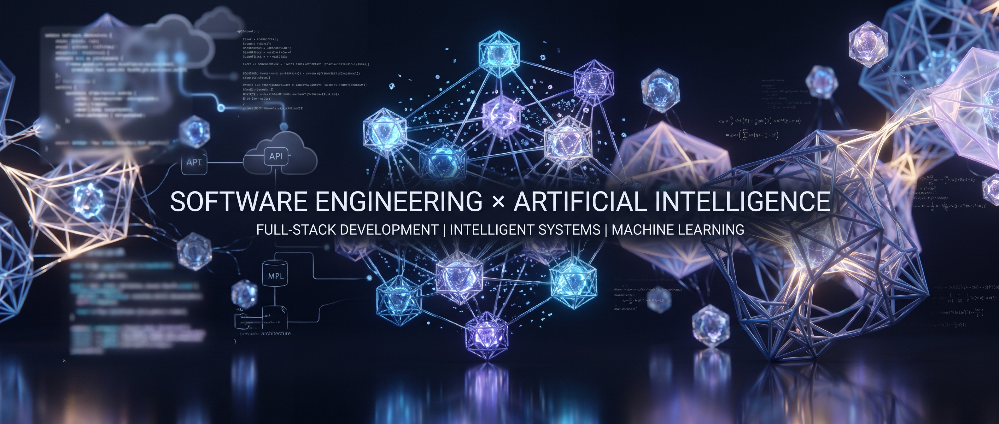
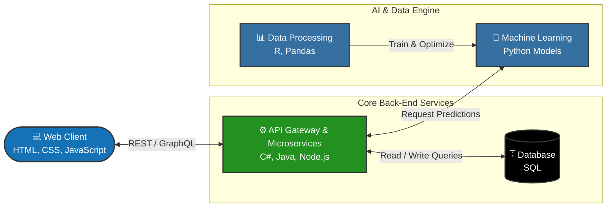
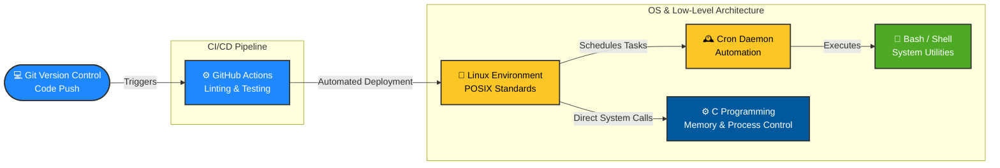

  

 

# Hi there 👋, I'm Hamed Payanda! 

**Full-Stack Software Developer | AI Developer** 

  &nbsp;

 

Welcome to my GitHub! I am a dedicated Full-Stack Software Developer engineering intelligent, data-driven systems, scalable web applications, and resilient Linux infrastructure. I specialize in building robust back-end architectures, integrating AI models, and automating secure enterprise workflows to create seamless user experiences.

###  About Me

-  **I’m currently working on:** developing scalable Full-Stack web applications and integrating custom AI models to build smarter, data-driven software solutions.
-  **I’m currently learning:** advanced deployment strategies for machine learning models, low-level memory management in C, and optimizing back-end architecture for high-performance applications.
-  **I’m looking to collaborate on:** Open-source AI tools, innovative Full-Stack projects, and system automation workflows.
-  **Ask me about:** Python, C#, JavaScript, back-end architecture, AI integration, C programming, and Linux shell automation.
-  **How to reach me:** Let's connect on [LinkedIn](https://linkedin.com/in/YOUR-PROFILE-URL) or reach out via email at hamedpayanda@gmail.com.
-  **Fun fact:** My programming journey started by snapping together visual code blocks in Scratch; today I build complex AI models, full-stack architectures, and custom UNIX environments!

---

###  Tech Stack & Tools

**Programming Languages**
 

**Frameworks & Back-End Platforms** 
 

**AI, Data & Libraries** 
 

**DevOps & Tools**
 

---

### 🏗️ How I Build Systems (Full-Stack AI Architecture)

---

### ⚙️ How I Automate & Manage Systems (Infrastructure & OS)

---

### 🏆 Featured Projects

* **[🧭 AI Career Coach](https://github.com/HAMED-PAYANDA/watsonx-gradio-career-coach)** - An interactive AI application suite featuring a resume polisher, cover letter generator, and career gap analyzer. Built using a Python/Gradio front-end integrated with IBM watsonx.ai (Meta Llama 4) cloud LLMs.

* **[🌐 Watsonx Voice Translator](https://github.com/HAMED-PAYANDA/watsonx-voice-translator)** - An end-to-end speech-to-speech translation web app that captures audio, translates contextually, and synthesizes speech. Built with a Python Flask backend, IBM Watson Speech Libraries (STT/TTS), watsonx.ai (Mistral), and containerized with Docker.
  
* **[🛡️ Secure Cron Backup](https://github.com/HAMED-PAYANDA/secure-cron-backup)** - A production-ready, POSIX-compliant Bash utility for automated daily file backups via Cron. Features epoch time validation, strict array parsing, and integrated ShellCheck CI/CD linting.

---

### 📊 GitHub Activity & Analytics

---

  

